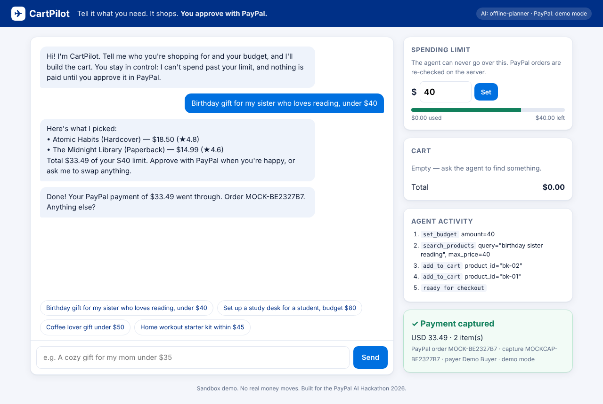

# CartPilot 🛒✈︎

**An AI shopping agent that shops for you and pays with PayPal, inside a spending limit you set.**

You tell CartPilot what you need in plain English ("a birthday gift for my sister who loves reading, under $40"). The agent searches the store, compares items, builds the cart and prepares a PayPal checkout. You keep control the whole time: the agent **cannot** spend past your limit, and **nothing is paid until you approve it in PayPal**.



## Why this matters

AI agents that buy things raise an obvious question: *how do I trust them with my money?* CartPilot answers it with three layers of protection:

1. **Tool guardrail.** The agent's `add_to_cart` tool rejects anything that would break the spending limit, so the model can't talk its way past it.
2. **Server-side re-pricing.** When a PayPal order is created, the server re-prices every item from its own catalog and re-checks the limit. Prices from the client or the AI are never trusted.
3. **Human approval through PayPal.** The agent only gets as far as `ready_for_checkout`. Only the shopper can approve a payment, in PayPal's own window.

Every action the agent takes appears live in the **Agent activity** panel, so you can see exactly what it did.

## How it works

```
Browser (chat + cart + PayPal Buttons)
   │  /api/chat
   ▼
Express server ── Agent loop (Gemini function calling)
   │                 tools: search_products, add_to_cart, remove_from_cart,
   │                        view_cart, set_budget, ready_for_checkout
   │  /api/orders  → PayPal Orders v2: create (itemized, intent CAPTURE)
   │  /api/orders/:id/capture → PayPal Orders v2: capture
   ▼
PayPal Sandbox
```

- **AI:** Google Gemini (`gemini-2.5-flash`) with function calling. If no API key is set, a built-in offline planner takes over so the demo still runs.
- **PayPal:** JavaScript SDK Smart Buttons on the frontend, and REST **Orders v2** (OAuth2 client credentials, itemized `purchase_units`, idempotent `PayPal-Request-Id`, capture) on the backend.

## Run it locally

Requirements: Node.js 18 or newer.

```bash
git clone https://github.com/<your-username>/cartpilot.git
cd cartpilot
npm install
cp .env.example .env      # then fill in the keys below
npm start                 # open http://localhost:3000
```

| Variable | Where to get it |
|---|---|
| `PAYPAL_CLIENT_ID`, `PAYPAL_CLIENT_SECRET` | [PayPal Developer Dashboard](https://developer.paypal.com/dashboard/applications/sandbox) → Apps & Credentials → Sandbox → Create App |
| `GEMINI_API_KEY` | [Google AI Studio](https://aistudio.google.com/apikey) (free tier) |

Without PayPal keys, the app runs in **demo mode** with a simulated checkout. With keys, it uses the real PayPal sandbox.

Run tests: `npm test`

## Testing it (for judges)

1. Open the hosted demo: `<DEMO_URL>`
2. Click a suggestion chip, or type something like *"Coffee lover gift under $50"*.
3. Watch the agent search and fill the cart, and see each step in **Agent activity**.
4. Click the PayPal button and log in with this **sandbox buyer** account:
   - Email: `<SANDBOX_BUYER_EMAIL>`
   - Password: `<SANDBOX_BUYER_PASSWORD>`
5. Approve. The receipt shows the PayPal order and capture IDs.
6. Try the guardrail: say *"set my budget to 10"*. Checkout is then blocked until the cart fits the limit.

## Project structure

```
server.js          Express API (chat, cart, budget, PayPal orders)
src/agent.js       Agent loop, tool definitions, Gemini + offline planner
src/paypal.js      PayPal OAuth + Orders v2 create/capture (with demo mode)
src/store.js       Catalog search, carts, spending-limit guardrail
src/catalog.json   Demo product catalog
public/            Frontend (vanilla JS, PayPal JS SDK)
test/              Unit tests (node:test)
```

## License

MIT. See [LICENSE](LICENSE).
